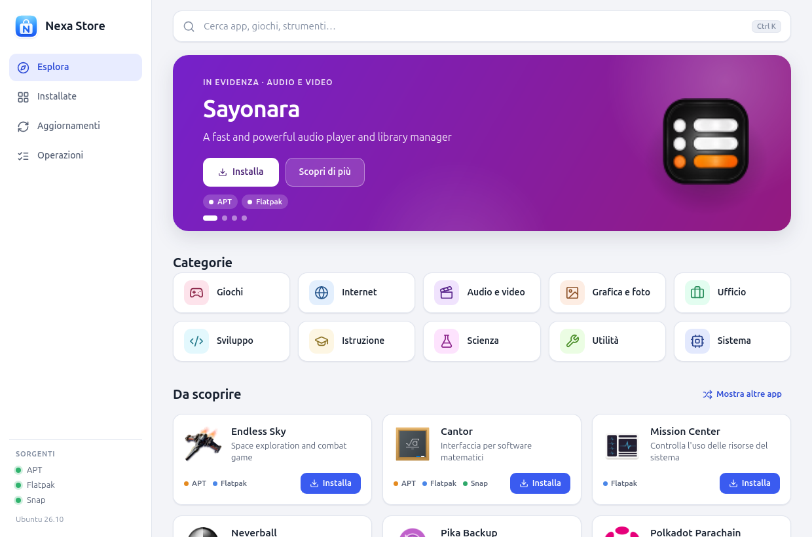

<p align="center"></p>

# Nexa Store

A desktop app store for Ubuntu: **search, discover and manage software from APT, Flatpak and Snap** in one interface, with a confirmation before every change. Built with **Tauri 2, React, TypeScript and Rust**. Light and dark themes follow the system.

> **Note:** the user interface is in **Italian**. The code, documentation and release notes are in English.

<p align="center">
  
  
</p>

## Features

- **Explore** – a highlighted app, ten **categories** (Games, Internet, Audio & video, Graphics & photo, Office, Development, Education, Science, Utilities, System) and **new proposals on every launch**, with a "show more apps" button. Every category has its own page, sortable and filterable by source.
- **One card per app** – an app that exists in APT, Flatpak and Snap appears once, with the available sources; you choose where to install it from in the details.
- **Search** by name – apps first, with the real name and **logo**; libraries and technical packages stay apart and can be included.
- **Installed** and **Updates** lists with removal and per-app updates, and an **Open** button to start installed apps.
- **Summary and confirmation** before every change, with dependencies, permissions and the exact command available.
- **Operations that keep going with the window closed** – you can close the store while it installs, and a **notification** tells you when it is done.
- A Debian package, a store icon and an optional launcher for the user's application menu.

There is no telemetry and no data is sent anywhere: everything is read from the local catalogs (and from the Snap Store through snapd).

| Source | Search | Scope of operations |
| --- | --- | --- |
| APT | Local indexes of the configured repositories | System packages, authorized through polkit |
| Flatpak | Already configured remotes | New installs per user; updates and removals in the scope of the existing app |
| Snap | Snap catalog through snapd, when available | One application at a time, with the restrictions below |

## Install

Download the `.deb` from the [latest release](../../releases/latest) and install it with APT, which pulls in the dependencies:

```bash
sudo apt install ./nexa-store_0.5.0_ubuntu26.10_amd64.deb
```

The package is built for **Ubuntu 26.10 on amd64**. On other Ubuntu versions, [build from source](#build-from-source): a binary built on a recent release can need newer libraries than an older one provides. The SHA-256 checksum is in `SHA256SUMS.txt` next to the package.

## Requirements

- **Ubuntu desktop** with a graphical session (developed and tested on Ubuntu 26.10, GNOME on Wayland).
- To build: **Node.js 20+**, npm, **Rust 1.90+** and Cargo.
- GTK 3, WebKitGTK 4.1 and the other development libraries Tauri needs (see the [Tauri prerequisites for Linux](https://v2.tauri.app/start/prerequisites/)).
- APT and polkit/`pkexec` for system operations.
- Flatpak and at least one remote to use the Flatpak catalog.
- Snap with a running snapd to use the Snap source. Its absence does not stop the other sources from working.

## Build from source

```bash
./scripts/setup-ubuntu.sh        # checks the system and installs missing build dependencies (asks first)
npm run desktop                  # development window with hot reload
```

The setup script lists the missing system packages and asks for explicit consent before running `sudo apt-get install --no-upgrade`. It does not upgrade the system, add repositories or configure Flatpak remotes. Snap is optional: pass `--with-snap` to include snapd in the request. It runs `npm ci` when `package-lock.json` is present; the first Rust build downloads the Cargo dependencies, so network access is required. **Do not run the app with `sudo`.**

To build and package:

```bash
npm run build
npm run test:rust
npm run package                  # .deb in src-tauri/target/release/bundle/deb/
```

To build only the binary:

```bash
npm run tauri -- build --no-bundle
```

> **Do not build with a plain `cargo build --release`.** Without Tauri's `custom-protocol` feature, which only the Tauri CLI enables, the binary looks for the development server (`127.0.0.1:1420`) instead of the bundled interface and will not start. Use `npm run tauri -- build …` or `npm run package`.

To run the release binary and add a launcher for the current user only:

```bash
./scripts/launch.sh
./scripts/install-launcher.sh
```

The launcher uses the project's absolute path, so run `install-launcher.sh` again after moving the folder. The window identifies itself to the system as `nexa-store`, so the `.desktop` file must contain `StartupWMClass=nexa-store`; otherwise the dock shows a generic icon. The launcher and the package both declare it. To remove the local launcher, delete `it.nexa.store.desktop` from `~/.local/share/applications/` and `it.nexa.store.svg` from `~/.local/share/icons/hicolor/scalable/apps/`.

## Categories, apps and logos

Categories come from the AppStream metadata of APT and Flatpak (the standard desktop menu categories) and from the Snap Store sections, mapped onto the same ten. An app can belong to several categories.

- **APT** – an item is an app if the distribution's AppStream metadata declares it a `desktop-application`, or if an installed package ships a visible `.desktop` file. A library or data package with an icon stays under technical packages.
- **Flatpak** – only `app/…` refs from the configured remotes are apps; runtimes, extensions, fonts and codecs are not offered.
- **Snap** – the type comes from snapd. Bases, kernels, gadgets, snapd and system components are technical packages; server and IoT components are not proposed on the home page.
- **The same app in several sources** is recognized by its AppStream id or its normalized name.
- **Names and descriptions** are shown in Italian when the catalog has them; APT apps show the app's own name, not the package name.

The home proposals are random: a deterministic generator starts from a new seed on every launch, so "show more" and later loads of a page stay consistent. A small list of well-known apps gets more weight, but local catalogs carry no popularity ranking.

Logos are **raster only** (PNG, JPEG, WebP), read locally from the AppStream catalogs, the icon theme and the folders of installed snaps, with a size limit and a check of the real file type. For snaps that are not installed, the https icon from the Snap Store is used, loaded without sending a referrer. SVGs are never shown and an icon path never comes from the interface. Some apps, especially command-line ones or those with vector-only icons, have no raster logo and show a neutral icon.

## Background operations and notifications

Once confirmed, an operation no longer depends on the window.

- If you **close the window while an operation is running**, the app hides instead of quitting and tells you with a notification ("Nexa Store continua in background"). When the work ends, a second notification arrives and the app quits by itself. If the operation **fails**, the window comes back with the details. Reopening the app while it works shows the window again.
- The end-of-operation notification is sent **always**, even with the window open and focused, for both success and failure.
- With no operation running, closing the window quits the app immediately.
- The output of APT, Flatpak and Snap is written to a **private temporary file** (deleted afterwards) and the command runs in its **own process group**, so stopping the app can never interrupt an installation half-way: the package manager never ends up with a closed pipe. An operation already started keeps going, but in that case no notification is sent.
- **The final notification survives the app's exit.** GNOME Shell deletes the notifications linked to an app as soon as the app leaves the D-Bus (about a second later). So the notification sent right before quitting is not linked to the app: it stays in the notification list until dismissed, like `notify-send` ones. `scripts/test-background.py` checks this on the D-Bus.
- Notifications use the standard desktop service (D-Bus); if it does not answer, `notify-send` is tried. If neither is available, the operation still proceeds. The text only says what was done and to which app; package names are stripped of any markup.

**Flatpak apps and the application menu.** Nexa Store installs Flatpaks for the user. The graphical session reads the application folders once, at login: if the user Flatpak export folder did not exist then, Flatpak apps installed afterwards do not appear in the menu, the dock or the search until you log out and back in once. The store detects this (by comparing `XDG_DATA_DIRS`), shows a notice and repeats it in the end-of-install notification; meanwhile **Open** starts them directly.

Limits: **one operation at a time**, each confirmed individually; with APT, Ubuntu may ask for the password at the start of each one.

## Safety

The backend validates identifiers and starts executables with explicit arguments; it never accepts arbitrary shell commands from the frontend. Every operation must be prepared, shown to the user and confirmed; plans expire after **2 minutes** and can be used **once**. State is checked again before execution. A single instance of the app runs one change at a time.

**APT.** The plan contains a real simulation, repeated before execution. Installs and upgrades are blocked if they require removals. Removing critical components, Essential/Protected packages or high-priority packages, and operations that remove more than 20 packages, are blocked. Local configuration is kept; no purge, autoremove or global upgrade is ever run. Search relies on local indexes and also includes libraries and command-line tools.

**Flatpak.** No remote is added automatically. New installs need a user remote; updates and removals keep the scope of the installed app. The confirmation shows the ref, the commit and the declared permissions. Updates pin the approved commit. For new installs Flatpak offers no option to pin the commit, so the ref, the commit and the remote configuration are checked again right before starting. Runtimes and dependencies are resolved by Flatpak during the transaction.

**Snap.** Only apps with **strict** confinement from the **stable** channel can be managed. Operations concern a single name: there is no global `snap refresh`. Classic, devmode and system components (kernel, gadget, base and snapd types) are excluded. The app's identity and conditions are checked again before execution. snapd keeps its own automatic-update policy; Nexa Store does not reconfigure it.

Always read the preview: actual dependencies, downloads and disk space depend on the package manager and the repository. The app does not force the removal of APT locks, does not change repositories or remotes and does not replace Ubuntu's recovery tools. Network, authorization or package-manager errors are reported in the result. The operations log lasts for the current session and is not stored as a persistent history.

## Tests

Run the Rust tests with `npm run test:rust`. After a release build, a smoke test of the local package managers is available; it installs, upgrades and removes nothing:

```bash
./src-tauri/target/release/nexa-store --smoke-test
```

`scripts/test-gui.py` is a **read-only** UI check of the real app: home, categories, changing proposals, a category page, search, details with source choice, logos, the installed list, a second launch of the app and an install confirmation (then cancelled). The only operation it runs is `snap refresh --list`, which lists updates without applying them:

```bash
python3 scripts/test-gui.py
```

It needs Python 3, `tauri-driver`, `WebKitWebDriver`, a graphical session and the release binary; set `NEXA_TAURI_DRIVER=/path/to/tauri-driver` if the driver is not in `PATH`. Reports and screenshots are written to `verification/`, which is not part of the repository. Do not run it while other operations are running in the app.

`scripts/test-background.py` checks operations with the window closed: it starts the Snap check from the UI (read-only, about half a second), closes the window while it runs with the same message the close button sends, and checks on the D-Bus that both notifications arrive, that the final one is not deleted after the app exits, and that the app quits by itself. It also checks that, with no operation, closing is immediate and silent. **Real notifications appear on the desktop during the run.** It additionally needs `dbus-monitor` and `xprop`:

```bash
python3 scripts/test-background.py
```

## Project layout

```text
src/                    React and TypeScript interface
  pages/                Explore, category, search, installed/updates, operations
  components/           Cards, banner, categories, detail and confirmation dialogs
  lib/                  Categories, source grouping, helpers
  styles.css            Styling, light and dark themes
src-tauri/src/          Rust backend
  backend.rs            APT, Flatpak and Snap operations and safety checks
  catalog.rs            Local AppStream catalogs and logos
  categories.rs         Category mapping
  notify.rs             Desktop notifications
  store.rs, popular.rs  Random home page and category pages
src-tauri/icons/        Desktop package icons (generated from icon.svg)
src-tauri/packaging/    .desktop template for the Debian package
scripts/                Ubuntu setup, launch, launcher and UI checks
icon.svg                Store icon (source)
CHANGELOG.md            Release notes
```

To regenerate the icons after editing `icon.svg`: `npx tauri icon icon.svg`.

## License

[MIT](LICENSE) © 2026 Foglio24
