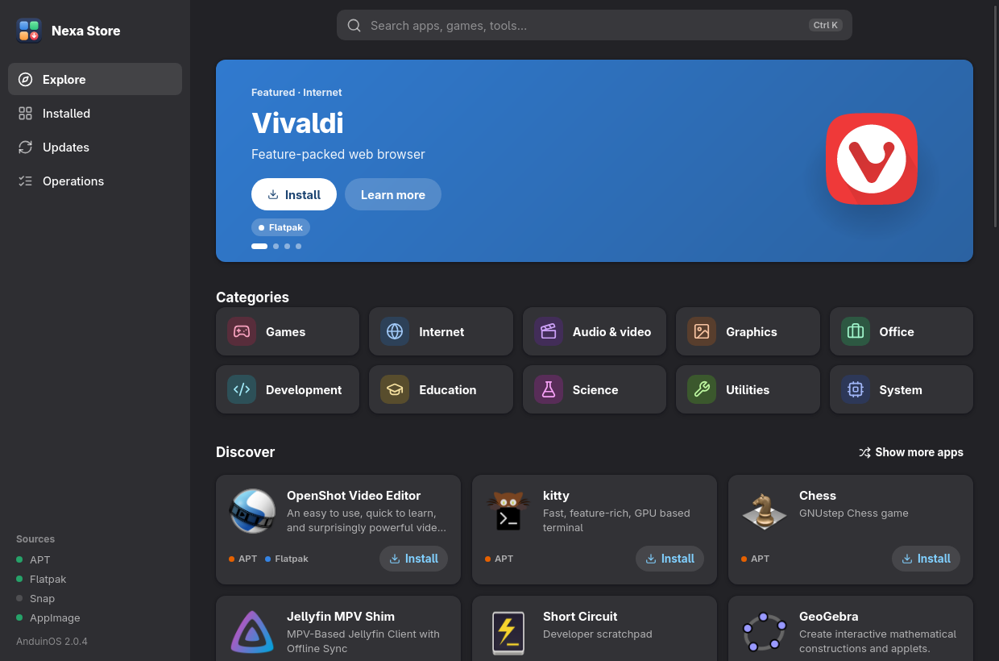
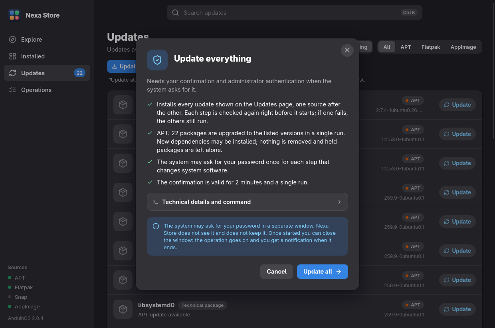

<p align="center"></p>

# Nexa Store

A desktop app store for **Debian, Ubuntu and the distributions based on them** (Linux Mint, Pop!_OS, Zorin OS, elementary OS, MX Linux, Kali, Raspberry Pi OS, AnduinOS, …): **search, discover and manage software from APT, Flatpak, Snap and AppImage** in one interface, with a confirmation before every change. Built with **Tauri 2, React, TypeScript and Rust**. The look follows GNOME's Adwaita style, and light and dark themes follow the system.

> **Language:** the interface follows the system language. It is shown in **Italian** when the system language is Italian and in **English** for every other language. See [Language](#language).

<p align="center">
  
  
</p>

## Features

- **Explore** – a highlighted app, ten **categories** (Games, Internet, Audio & video, Graphics, Office, Development, Education, Science, Utilities, System) and **new proposals on every launch**, with a "show more apps" button. Every category has its own page, sortable and filterable by source.
- **One card per app** – an app that exists in APT, Flatpak, Snap and AppImage appears once, with the available sources; you choose where to install it from in the details.
- **AppImage** – a catalog of about 2,900 AppImage apps ([AppImageHub](https://appimage.github.io)), installed per user from the project's latest GitHub release with a checksum check. See [AppImage](#appimage).
- **Available in English and Italian**, following the system language.
- **Search** by name – apps first, with the real name and **logo**; libraries and technical packages stay apart and can be included.
- **Installed** and **Updates** lists with removal and per-app updates, and an **Open** button to start installed apps.
- **"Update all"** installs every available update in one confirmation: the APT packages in a single upgrade (only the versions listed, never a removal, held packages left alone), each Flatpak installation, each Snap and each AppImage. Every step is checked again right before it starts, and one that fails does not stop the others.
- **One "Check for updates" button**: it refreshes the APT package lists (so updates from third-party repositories show up too), the Flatpak catalog and the Snap list in one go, then shows what can be updated. The APT lists are refreshed through PackageKit, like the system's software updater does, so **no password is asked**. Without the button the page only reads the lists already on the computer.
- **Summary and confirmation** before every change, with dependencies, permissions and the exact command available.
- **Operations that keep going with the window closed** – you can close the store while it installs, and a **notification** tells you when it is done.
- A Debian package, a store icon and an optional launcher for the user's application menu.

There is no telemetry and no data about you is sent anywhere. Apps are read from the local catalogs (and from the Snap Store through snapd); the AppImage source is the only one that uses the network on its own: it reads the public AppImageHub catalog and, when you ask for an app, GitHub's API and releases.

| Source | Search | Scope of operations |
| --- | --- | --- |
| APT | Local indexes of the configured repositories | System packages, authorized through polkit |
| Flatpak | Already configured remotes, user and system | New installs in the scope of the remote (per user, or system-wide when the distribution configured Flathub for everyone); updates and removals in the scope of the existing app |
| Snap | Snap catalog through snapd, when available | One application at a time, with the restrictions below |
| AppImage | AppImageHub catalog (GitHub projects), cached on disk | Per user, in the home folder: no administrator rights |

## Supported distributions

Nexa Store runs on **Debian, Ubuntu and every distribution based on them**: it checks `ID` and `ID_LIKE` in `/etc/os-release` (`debian` or `ubuntu`) and, for a derivative that does not declare its family, that the system is managed by dpkg and APT. Tauri 2 needs **WebKitGTK 4.1**, so the minimum releases are:

| Family | Minimum release | Examples |
| --- | --- | --- |
| Debian | Debian 12 "bookworm" | Debian 12/13, MX Linux 23, Kali, Raspberry Pi OS (bookworm), PureOS, Devuan 5 |
| Ubuntu | Ubuntu 22.04 LTS | Ubuntu and its flavours, Linux Mint 21/22, Pop!_OS 22.04/24.04, Zorin OS 17, elementary OS 7/8, AnduinOS |

What changes between distributions is handled at run time:

- **APT catalog** – the AppStream metadata is read from `/var/lib/swcatalog` (AppStream 1.0: Debian 13, Ubuntu 24.04 and later) and from `/var/lib/app-info` (older releases). Install the `appstream` package if the APT categories stay empty, then run "Check for updates" once.
- **Flatpak** – both user and system remotes are used. Many derivatives ship Flathub as a system remote: apps from it are installed system-wide. With no remote at all, add Flathub with `flatpak remote-add --user --if-not-exists flathub https://dl.flathub.org/repo/flathub.flatpakrepo`.
- **Snap** – optional. Linux Mint, AnduinOS, Debian and others ship without it on purpose: the source is simply turned off, with no warning. A warning appears only when the `snap` command exists but snapd does not answer.
- **pkexec** – from the `pkexec` package (Debian 12, Ubuntu 24.04 and later) or from `policykit-1` (older releases). The Debian package accepts either.
- **FUSE 2 for AppImages** – `libfuse2t64` (Debian 13, Ubuntu 24.04 and later) or `libfuse2` (older releases), recommended, not required.

## Install

Download the `.deb` from the [latest release](../../releases/latest) and install it with APT, which pulls in the dependencies:

```bash
sudo apt install ./nexa-store_0.7.0_amd64.deb
```

The released package is built for **amd64** and needs **glibc 2.39 or later**: Ubuntu 24.04 and later, Debian 13 and later, Linux Mint 22, Pop!_OS 24.04, AnduinOS 2 and other derivatives on those bases. On older releases (Debian 12, Ubuntu 22.04, Linux Mint 21…), or if APT reports unmet dependencies, [build from source](#build-from-source) on that system — it takes a few minutes and produces a package for exactly that release. The SHA-256 checksum is in `SHA256SUMS.txt` next to the package.

## Requirements

- **Debian, Ubuntu or a derivative** (see [Supported distributions](#supported-distributions)) with a graphical session. Developed on Ubuntu 26.04/26.10 and AnduinOS 2 (GNOME on Wayland).
- To build: **Node.js 20+**, npm, **Rust 1.90+** and Cargo. Where the distribution's packages are older (Debian 12: Rust 1.63, Node.js 18), install Rust with [rustup](https://rustup.rs/) and Node.js from [nodejs.org](https://nodejs.org/en/download).
- GTK 3, WebKitGTK 4.1 and the other development libraries Tauri needs (see the [Tauri prerequisites for Linux](https://v2.tauri.app/start/prerequisites/)).
- APT and polkit/`pkexec` for system operations.
- Flatpak and at least one remote (user or system) to use the Flatpak catalog.
- Snap with a running snapd to use the Snap source. Its absence does not stop the other sources from working.
- A network connection for the AppImage source. FUSE 2 (`libfuse2t64` or `libfuse2`) is recommended so AppImages start directly.

## Build from source

```bash
./scripts/setup.sh               # checks the system and installs missing build dependencies (asks first)
npm run desktop                  # development window with hot reload
```

The setup script recognises any Debian or Ubuntu based system, picks the package names that release uses (`pkexec` or `policykit-1`, `libfuse2t64` or `libfuse2`, …), lists the missing system packages and asks for explicit consent before running `sudo apt-get install --no-upgrade`. The distribution's Rust and Node.js are used only when they are recent enough; otherwise it says where to get them and stops. It does not upgrade the system, add repositories or configure Flatpak remotes. Snap is optional: pass `--with-snap` to include snapd in the request. It runs `npm ci` when `package-lock.json` is present; the first Rust build downloads the Cargo dependencies, so network access is required. **Do not run the app with `sudo`.** (`scripts/setup-ubuntu.sh` still works and runs the same script.)

To build and package:

```bash
npm run build
npm run test:rust
npm run package                  # .deb in src-tauri/target/release/bundle/deb/
```

To build only the binary:

```bash
npm run tauri -- build --no-bundle
```

> **Do not build with a plain `cargo build --release`.** Without Tauri's `custom-protocol` feature, which only the Tauri CLI enables, the binary looks for the development server (`127.0.0.1:1420`) instead of the bundled interface and will not start. Use `npm run tauri -- build …` or `npm run package`.

To run the release binary and add a launcher for the current user only:

```bash
./scripts/launch.sh
./scripts/install-launcher.sh
```

The launcher uses the project's absolute path, so run `install-launcher.sh` again after moving the folder. The window identifies itself to the system as `nexa-store`, so the `.desktop` file must contain `StartupWMClass=nexa-store`; otherwise the dock shows a generic icon. The launcher and the package both declare it. To remove the local launcher, delete `it.nexa.store.desktop` from `~/.local/share/applications/` and `it.nexa.store.svg` from `~/.local/share/icons/hicolor/scalable/apps/`.

## Categories, apps and logos

Categories come from the AppStream metadata of APT and Flatpak (the standard desktop menu categories), from the Snap Store sections and from the AppImageHub categories, mapped onto the same ten. An app can belong to several categories.

- **APT** – an item is an app if the distribution's AppStream metadata declares it a `desktop-application`, or if an installed package ships a visible `.desktop` file. A library or data package with an icon stays under technical packages.
- **Flatpak** – only `app/…` refs from the configured remotes are apps; runtimes, extensions, fonts and codecs are not offered.
- **Snap** – the type comes from snapd. Bases, kernels, gadgets, snapd and system components are technical packages; server and IoT components are not proposed on the home page.
- **AppImage** – every catalog entry is an app. Most of them are little known, so the home page only proposes the well-known ones; all of them are in their category and in search.
- **The same app in several sources** is recognized by its AppStream id or its normalized name.
- **Names and descriptions** come from the catalogs. With the interface in Italian the Italian text is used when the catalog has it; otherwise (and for every other language) the original English text. APT apps show the app's own name, not the package name.

The home proposals are random: a deterministic generator starts from a new seed on every launch, so "show more" and later loads of a page stay consistent. A small list of well-known apps gets more weight, but local catalogs carry no popularity ranking.

Logos are **raster only** (PNG, JPEG, WebP), read locally from the AppStream catalogs, the icon theme and the folders of installed snaps, with a size limit and a check of the real file type. For snaps that are not installed, the https icon from the Snap Store is used, and for AppImages the PNG icon of the AppImageHub database; both are loaded without sending a referrer. SVGs are never shown and an icon path never comes from the interface. Some apps, especially command-line ones or those with vector-only icons, have no raster logo and show a neutral icon.

## Background operations and notifications

Once confirmed, an operation no longer depends on the window.

- If you **close the window while an operation is running**, the app hides instead of quitting and tells you with a notification ("Nexa Store keeps going in the background"). When the work ends, a second notification arrives and the app quits by itself. If the operation **fails**, the window comes back with the details. Reopening the app while it works shows the window again.
- The end-of-operation notification is sent **always**, even with the window open and focused, for both success and failure.
- With no operation running, closing the window quits the app immediately.
- The output of APT, Flatpak and Snap is written to a **private temporary file** (deleted afterwards) and the command runs in its **own process group**, so stopping the app can never interrupt an installation half-way: the package manager never ends up with a closed pipe. An operation already started keeps going, but in that case no notification is sent.
- **The final notification survives the app's exit.** GNOME Shell deletes the notifications linked to an app as soon as the app leaves the D-Bus (about a second later). So the notification sent right before quitting is not linked to the app: it stays in the notification list until dismissed, like `notify-send` ones. `scripts/test-background.py` checks this on the D-Bus.
- Notifications use the standard desktop service (D-Bus); if it does not answer, `notify-send` is tried. If neither is available, the operation still proceeds. The text only says what was done and to which app; package names are stripped of any markup.

**Flatpak apps and the application menu.** From a user remote Nexa Store installs Flatpaks for the user. The graphical session reads the application folders once, at login: if the user Flatpak export folder did not exist then, Flatpak apps installed afterwards do not appear in the menu, the dock or the search until you log out and back in once. The store detects this (by comparing `XDG_DATA_DIRS`), shows a notice and repeats it in the end-of-install notification; meanwhile **Open** starts them directly.

Limits: **one operation at a time**, each confirmed individually; with APT, the system may ask for the password at the start of each one.

## Language

The interface and the messages of the backend (confirmations, errors, notifications) follow the **system language**, resolved the way gettext does: `LC_ALL`, `LC_MESSAGES` or `LANG` give the locale, and `LANGUAGE`, a preference list such as `de:it:en`, picks the first entry that is Italian or English.

- Italian system → **Italian**.
- Any other language (English, German, French, Spanish, Japanese, `C`/`POSIX`, …) → **English**.
- To try the other language, start the app with `NEXA_LANG=it` or `NEXA_LANG=en`.

Texts in the code are written in English. The Italian ones live in `src/i18n/it.ts` (interface) and `src-tauri/src/i18n/it.rs` (backend), keyed by the English text. `npm run test:i18n` and the Rust tests check that every message has an Italian text, that placeholders match and that no entry is left unused. A message with no entry is shown in English, never as an error. Names and descriptions from the system catalogs use Italian when the interface is Italian and the catalog has it. Other languages are not translated: adding one means adding a dictionary and teaching `i18n::detect` (and `languageFromTags`) its language code.

## AppImage

An AppImage is a single executable file with no package manager, no sandbox and no signature the store can verify, so this source is deliberately narrow.

- **Catalog**: the public [AppImageHub](https://appimage.github.io) feed, kept in `~/.cache/nexa-store/` and refreshed every three days (an old copy is used when offline). Only projects hosted on GitHub are offered, about 2,900 apps. Some well-known apps (GIMP, Krita, Inkscape…) publish their AppImages elsewhere and are not in this source.
- **Install**: Nexa Store downloads the AppImage of the project's **latest stable GitHub release** for this computer's architecture, over https. The confirmation shows the file, its size, the release and the checksum GitHub publishes for it. The file is accepted only if its size and SHA-256 match (when GitHub publishes one; otherwise the confirmation says so and the result shows the SHA-256) and if it has the AppImage file header. Only then is it made executable.
- **Where**: `~/.local/share/nexa-store/appimages/<owner>/<repo>/`, plus a launcher in `~/.local/share/applications/`. Nothing outside the home folder changes and no administrator password is asked. Without FUSE 2 the launcher unpacks the app before starting it.
- **Addresses**: only `https` and only `github.com`, `api.github.com`, `*.githubusercontent.com` (release downloads) and `appimage.github.io` (catalog and icons), checked again on every redirect.
- **Update / remove**: an update is offered when the latest release tag differs from the installed one; removing deletes the folder and the launcher and keeps the app's own settings.
- **Not sandboxed**: an AppImage runs with all the permissions of your user. The confirmation and the details say so; install apps only from authors you trust. Nexa Store cannot vouch for the software, only for what it downloaded.

## Safety

The backend validates identifiers and starts executables with explicit arguments; it never accepts arbitrary shell commands from the frontend. Every operation must be prepared, shown to the user and confirmed; plans expire after **2 minutes** and can be used **once**. State is checked again before execution. A single instance of the app runs one change at a time.

**APT.** The plan contains a real simulation, repeated before execution. Installs and upgrades are blocked if they require removals. Removing critical components, Essential/Protected packages or high-priority packages, and operations that remove more than 20 packages, are blocked. Local configuration is kept; no purge, autoremove, `dist-upgrade` or `full-upgrade` is ever run. "Update all" upgrades exactly the packages `apt list --upgradable` shows, each pinned to the listed version, with `--only-upgrade --no-remove`, after a simulation that is repeated right before it runs; held packages are left out. Search relies on local indexes and also includes libraries and command-line tools.

**Flatpak.** No remote is added automatically. New installs go to the scope of the remote that offers the app: per user from a user remote, system-wide from a system remote (Linux Mint, Pop!_OS, Zorin OS, elementary OS, AnduinOS and others configure Flathub that way; Flatpak's own polkit policy decides whether a password is needed). Updates and removals keep the scope of the installed app. The confirmation shows the ref, the commit and the declared permissions. Updates pin the approved commit. For new installs Flatpak offers no option to pin the commit, so the ref, the commit and the remote configuration are checked again right before starting. Runtimes and dependencies are resolved by Flatpak during the transaction.

**Check for updates.** It runs, one after the other and each with its own re-check right before it starts, the APT list refresh, `flatpak update --appstream` (`--user` when only user remotes exist) and `snap refresh --list`. The APT lists are refreshed with a single D-Bus call to PackageKit (`RefreshCache`): PackageKit's polkit rule `org.freedesktop.packagekit.system-sources-refresh` lets a person using the computer do that without a password, and Nexa Store adds no rule, helper or privileged code. If PackageKit is missing or refuses, it falls back to `pkexec apt-get update` and says so (that one asks for the password). A source that is missing or cannot be refreshed is skipped and said so; a step that fails does not stop the others and the result lists each step. It installs and upgrades nothing, and a notification says how many updates were found. Installing, updating and removing APT packages still asks for the administrator password, on purpose.

**Update all.** One confirmation lists every step; each step is checked again right before it starts and runs only if nothing changed (the APT simulation, the Flatpak remotes, each Snap's identity, channel and revision). APT runs as one `pkexec apt-get --only-upgrade --no-remove install` of the listed versions. Each Flatpak installation with updates runs `flatpak update` (`--user`, or `--system` where polkit may ask for a password); unlike a single update it takes the latest commit of each app and runtime rather than a pinned one, and it adds no remote and removes no runtime. Each Snap and each AppImage is updated on its own, with the checks of a single update. The system may ask for the password once per step that changes system software. A failed step (a cancelled password prompt, no network) is reported and the others still run.

**Snap.** Only apps with **strict** confinement from the **stable** channel can be managed. Operations concern a single name: there is no global `snap refresh`. Classic, devmode and system components (kernel, gadget, base and snapd types) are excluded. The app's identity and conditions are checked again before execution. snapd keeps its own automatic-update policy; Nexa Store does not reconfigure it.

**AppImage.** The identifier is a validated `owner/repo`; every address is checked against an allow-list, redirects included; the download is bounded in size and time and written to a private partial file that is deleted on any failure; size, checksum and file header are verified before the file becomes executable; paths are built from validated parts and the install record is re-validated before every use (a hand-edited or symlinked record is ignored). Removal only deletes the app's own folder and a launcher this module wrote.

Always read the preview: actual dependencies, downloads and disk space depend on the package manager and the repository. The app does not force the removal of APT locks, does not change repositories or remotes and does not replace the distribution's recovery tools. Network, authorization or package-manager errors are reported in the result. The operations log lasts for the current session and is not stored as a persistent history.

## Tests

Run the Rust tests with `npm run test:rust` and the translation check with `npm run test:i18n`. After a release build, a smoke test of the local package managers is available; it installs, upgrades and removes nothing:

```bash
./src-tauri/target/release/nexa-store --smoke-test
```

`scripts/test-gui.py` is a **read-only** UI check of the real app: home, categories, changing proposals, a category page, search, details with source choice, logos, the installed list, a second launch of the app and an install confirmation and the update-check confirmation (both cancelled). It never runs an operation unless you set `NEXA_RUN_CHECK=1`, which also runs the update check (it refreshes the package lists and installs nothing; no password is asked when PackageKit allows it, otherwise the system asks for it):

```bash
python3 scripts/test-gui.py
```

The script runs the app in English; use `NEXA_LANG=it python3 scripts/test-gui.py` for the Italian run. It needs Python 3, `tauri-driver`, `WebKitWebDriver`, a graphical session and the release binary; set `NEXA_TAURI_DRIVER=/path/to/tauri-driver` if the driver is not in `PATH`. Reports and screenshots are written to `verification/`, which is not part of the repository. Do not run it while other operations are running in the app.

`scripts/test-background.py` checks operations with the window closed: it starts the Snap check (read-only, about half a second) through the app's backend commands, the same ones the interface calls (the interface's single check button also refreshes APT), closes the window while it runs with the same message the close button sends, and checks on the D-Bus that both notifications arrive, that the final one is not deleted after the app exits, and that the app quits by itself. It also checks that, with no operation, closing is immediate and silent. **Real notifications appear on the desktop during the run.** It additionally needs `dbus-monitor` and `xprop`:

```bash
python3 scripts/test-background.py
```

`scripts/test-language.py` starts the real app with different `LANG`/`LANGUAGE`/`LC_MESSAGES` values (never `NEXA_LANG`) and checks that it comes up in Italian for Italian and in English for everything else. It changes nothing.

`scripts/test-appimage.py` is an end-to-end check of the AppImage source: through the interface it searches the catalog, installs a real AppImage (KDiskMark, about 47 MiB) from GitHub, checks the file, the checksum and the launcher, lists it as installed and removes it again. The app runs with `XDG_DATA_HOME` and `XDG_CACHE_HOME` pointing at a temporary folder, so nothing is written to your real home, and the app is never started. It needs network access.

## Project layout

```text
src/                    React and TypeScript interface
  pages/                Explore, category, search, installed/updates, operations
  components/           Cards, banner, categories, detail and confirmation dialogs
  lib/                  Categories, source grouping, helpers
  i18n/                 Language handling and the Italian texts of the interface
  styles.css            Styling, light and dark themes
src-tauri/src/          Rust backend
  backend.rs            APT, Flatpak and Snap operations and safety checks
  catalog.rs            Local AppStream catalogs and logos
  appimage.rs           AppImage catalog, verified downloads, install, update, remove
  i18n/                 Language detection and the Italian texts of backend messages
  categories.rs         Category mapping
  notify.rs             Desktop notifications
  store.rs, popular.rs  Random home page and category pages
src-tauri/icons/        Desktop package icons (generated from icon.svg)
src-tauri/packaging/    .desktop template for the Debian package
scripts/                Setup (Debian/Ubuntu family), launch, launcher, UI and language checks
icon.svg                Store icon (source)
CHANGELOG.md            Release notes
```

To regenerate the icons after editing `icon.svg`: `npx tauri icon icon.svg`.

## License

[MIT](LICENSE) © 2026 Foglio24
